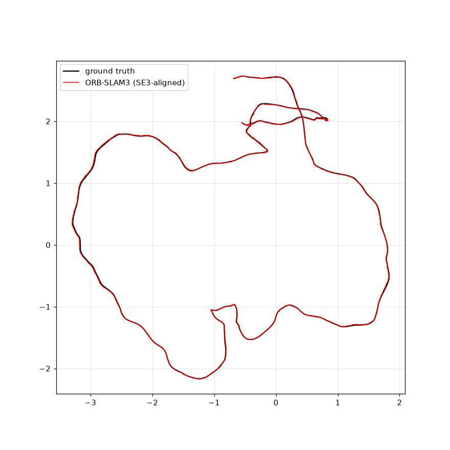
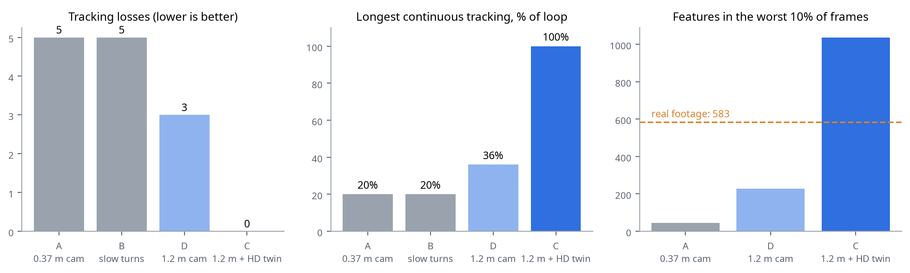

# visual_Slam2Nav

**From real RGB-D video to a robot that maps, is tested, and drives itself inside a digital twin of a real apartment.**


*Our robot inside a 3D copy of a real apartment. Every piece of furniture comes from an RGB-D scan
that we mapped with ORB-SLAM3, fused into a mesh, and exported to Gazebo.*

This project chains together the whole visual-robotics stack on one laptop (CPU only, no GPU):

1. **Visual SLAM** on real RGB-D video, using ORB-SLAM3.
2. **Dense 3D reconstruction** using TSDF fusion.
3. **Digital twin** export to the Gazebo Harmonic simulator.
4. **SLAM evaluation in simulation** against perfect ground truth.
5. **Autonomous click-to-go navigation**, using A*, pure pursuit and lidar replanning.

The full illustrated guide (30 pages, written in plain language) is in **[docs/Visual_SLAM_Project_Guide.pdf](docs/Visual_SLAM_Project_Guide.pdf)**.

---

## Results at a glance

| What | Result |
|---|---|
| ORB-SLAM3 (RGB-D) on TUM *fr3_long_office_household*, real video, 22.1 m loop | **1.01 cm** ATE (max 3.0 cm), loop closed |
| ORB-SLAM3 (RGB-D) on Stanford BundleFusion *apt0*, 89 m through an apartment | One continuous map, 9.65 cm vs reference poses |
| Apartment digital twin | 5.9 x 5.8 m, 1 cm TSDF, 1M triangles, 8K texture |
| ORB-SLAM3 on the robot's camera **inside the twin** (14.9 m loop) | **2.08 cm** ATE against exact ground truth, zero tracking losses |
| Autonomous navigation | Reaches clicked goals within ~10 cm, replans around unexpected obstacles, reports when a goal is cut off |

## How it fits together


| Stage | What happens | Tool |
|---|---|---|
| 1. Record | Colour + depth video from public datasets | TUM RGB-D, BundleFusion |
| 2. Localize | Camera pose for every frame | ORB-SLAM3 (RGB-D) |
| 3. Map | Depth images fused at those poses into a coloured mesh | Open3D TSDF (`VoxelBlockGrid`) |
| 4. Twin | Level, square, simplify and texture the mesh; write a Gazebo model + world | `tools/export_gazebo.py` |
| 5. Robot | Differential-drive robot with lidar, RGB-D camera, IMU, ground-truth pose | Gazebo Harmonic, SDF |
| 6. Test SLAM | Robot drives a loop; ORB-SLAM3 maps from its camera; scored against exact pose | `tools/sim_collect.py`, `tools/eval_segments.py` |
| 7. Navigate | Click a goal: A* plan, pure-pursuit control, lidar replanning | `tools/navigate.py` |

---

## 1. Visual SLAM on real video

ORB-SLAM3 tracks ORB features from frame to frame, builds a keyframe map, and closes loops when it recognises a place it has seen before.

<p align="center">
  
</p>

On the TUM office sequence, the estimated path (red) lies on top of the motion-capture ground truth (black):

<p align="center">
  
</p>

## 2. Dense 3D map

Every depth image is placed at its SLAM pose and fused into a truncated signed distance field. Marching cubes then extracts a mesh from it.


## 3. Digital twin in Gazebo

`tools/export_gazebo.py` turns the raw mesh into a simulator-ready model:


- **Level**: RANSAC finds the floor. Gravity is estimated as the camera's down-axis averaged over the whole walk.
- **Square**: rotate so the walls align with x and y.
- **Simplify**: quadric decimation produces two meshes, one for rendering and one for physics. The physics mesh gets a flat floor, because the lumpy scanned floor stalls wheels.
- **Texture**: a fast per-triangle texture atlas. Triangles are placed in Morton (Z-order) so neighbouring triangles sit next to each other in the image, and each texel is coloured from the full-resolution mesh.

<p align="center">
  
</p>

## 4. The robot: scout_bot

<p align="center">
  
</p>

| Sensor / actuator | Topic | Details |
|---|---|---|
| Differential drive | `/cmd_vel`, `/odom` | 2 wheels, r = 5 cm, 0.28 m apart |
| 2D lidar (`gpu_lidar`) | `/scan` | 360 beams, 10 Hz, 0.12 to 8 m |
| RGB-D camera | `/camera/image`, `/camera/depth_image` | 640x480, 15 Hz, 60° FOV |
| IMU | `/imu` | 100 Hz |
| Ground truth (`PosePublisher`) | `/model/scout_bot/pose` | Exact pose, 100 Hz |


## 5. Testing SLAM inside the twin

The simulator knows the robot's exact position, so SLAM can be scored perfectly, and conditions can be changed one at a time:


| Run | Change | Tracking losses | Longest continuous tracking | Error |
|---|---|---|---|---|
| A | Camera at 0.37 m, 2 cm twin | 5 | 3.4 m (20%) | ~1 cm per segment |
| B | A + slower turns | 5 (same places) | 3.5 m (20%) | ~1 cm per segment |
| D | Camera at 1.2 m (scanner height) | 3 (+2 map merges) | 5.5 m (36%) | ~1 cm per segment |
| **C** | **D + 1 cm HD twin** | **0** | **14.9 m (100%)** | **2.08 cm overall** |




**Finding:** a scanned twin is trustworthy for testing SLAM only when it was **scanned from the robot's viewpoint** and has **sharp enough texture**. Fixing either one alone was not enough.

## 6. Autonomous navigation

Click a point on the floor plan and the robot plans, drives and avoids surprises:


<p align="center">
  
  
</p>

- **Map**: a 5 cm occupancy grid built from the scanned mesh, inflated by the robot's radius using a distance transform.
- **Plan**: A* on an 8-connected grid, with a clearance-weighted cost so routes stay centred in corridors.
- **Follow**: pure pursuit with a 0.35 m look-ahead. The robot turns in place for sharp corners and slows near the goal.
- **Safety**: if the lidar sees an unmapped obstacle within 30 cm ahead, the robot stops, adds the obstacle to its map and replans to the same goal. If the goal is cut off, it reports BLOCKED; it never substitutes another goal.

---

## Quick start

### Requirements

- Ubuntu 24.04, Python 3.12
- Build tools and libraries:
  ```bash
  sudo apt-get install -y build-essential cmake pkg-config libeigen3-dev libopencv-dev libglew-dev libepoxy-dev \
      libgl1-mesa-dev libwayland-dev libxkbcommon-dev wayland-protocols libboost-serialization-dev libssl-dev python3-dev
  ```
- Gazebo Harmonic (`gz-harmonic`, from the [OSRF apt repository](https://gazebosim.org/docs/harmonic/install_ubuntu)); this also installs its Python bindings.
- Python environment:
  ```bash
  python3 -m venv .venv
  .venv/bin/python -m pip install open3d numpy scipy matplotlib opencv-python reportlab pypdf
  # let the venv import Gazebo's Python bindings (python3-gz-transport13, python3-gz-msgs10)
  echo /usr/lib/python3/dist-packages > $(.venv/bin/python -c "import site; print(site.getsitepackages()[0])")/zz_system_gz.pth
  ```

### ORB-SLAM3

```bash
mkdir -p third_party && cd third_party
git clone --depth 1 https://github.com/UZ-SLAMLab/ORB_SLAM3.git
git clone --depth 1 --branch v0.8 https://github.com/stevenlovegrove/Pangolin.git
cd ..
tools/build_orbslam3.sh   # applies tools/orbslam3_ubuntu24.patch (C++17, GCC 13 fix, map export) and builds
```

### Data

```bash
mkdir -p data && cd data
# TUM office sequence (1.5 GB)
curl -LO https://cvg.cit.tum.de/rgbd/dataset/freiburg3/rgbd_dataset_freiburg3_long_office_household.tgz
tar xzf rgbd_dataset_freiburg3_long_office_household.tgz
# Stanford BundleFusion apartment (1.2 GB)
curl -LO https://graphics.stanford.edu/projects/bundlefusion/data/apt0/apt0.zip
mkdir apt0 && unzip -q apt0.zip -d apt0
cd ..
```

### Run every stage

```bash
# SLAM + dense map on the office video (live viewer; ORB_NO_VIEWER=1 for headless)
tools/run_orbslam3.sh

# apartment: convert to TUM format, then SLAM + 2 cm dense map
.venv/bin/python tools/prepare_bundlefusion.py data/apt0/apt0
MAP_ARGS="--voxel 0.02 --depth-max 4" tools/run_orbslam3.sh \
    data/apt0/apt0 data/apt0/apt0/associations.txt data/apt0/apt0.yaml runs/apt0

# view any map in 3D (mesh | cloud | sparse)
.venv/bin/python tools/view_map.py --run runs/apt0

# export the twin to Gazebo (2 cm version, then the 1 cm HD version with the same alignment)
.venv/bin/python tools/export_gazebo.py --run runs/apt0 --name apt0
mkdir -p runs/apt0_1cm && cp runs/apt0/*.txt runs/apt0_1cm/          # same SLAM poses, re-fused at 1 cm
.venv/bin/python tools/build_map.py --data data/apt0/apt0 --run runs/apt0_1cm \
    --assoc data/apt0/apt0/associations.txt --config data/apt0/apt0.yaml --voxel 0.01 --depth-max 4
.venv/bin/python tools/export_gazebo.py --run runs/apt0_1cm --name apt0_hd --align-like apt0 \
    --visual-tris 1000000 --collision-tris 100000 --tex-size 8192 --texture per-triangle

# drive the robot yourself (arrow keys, S = stop)
tools/run_gazebo.sh apt0_hd_robot

# record a SLAM test drive with ground truth, run SLAM on it, score it
.venv/bin/python tools/sim_collect.py --out data/sim_run --gui --map apt0_hd \
    --world apt0_hd_robot_tall --cam-z 1.20 --obst-top 1.3
tools/run_orbslam3.sh data/sim_run data/sim_run/associations.txt data/sim_run/camera.yaml runs/sim_run
.venv/bin/python tools/eval_segments.py --run runs/sim_run --gt data/sim_run/groundtruth.txt

# click-to-go autonomous navigation
.venv/bin/python tools/navigate.py
```

---

## Repository layout

```
tools/
  build_orbslam3.sh        build Pangolin + ORB-SLAM3 into third_party/ (applies the patch below)
  orbslam3_ubuntu24.patch  our ORB-SLAM3 changes: C++17, GCC 13 fix, SaveMapPoints(), ORB_NO_VIEWER
  run_orbslam3.sh          run ORB-SLAM3 RGB-D, then build maps + evaluation
  build_map.py             ATE (Umeyama SE3/Sim3), sparse map, TSDF dense map, previews
  prepare_bundlefusion.py  BundleFusion -> TUM format + ORB-SLAM3 camera YAML
  view_map.py              interactive 3D viewer (Open3D)
  export_gazebo.py         mesh -> levelled, textured Gazebo model + world
  run_gazebo.sh            launch a world with the model path set
  sim_collect.py           autonomous recording drive with exact ground truth
  eval_segments.py         per-segment ATE for runs that split into several maps
  navigate.py              click-to-go navigation (A*, pure pursuit, lidar replanning)
gazebo/
  models/                  apt0, apt0_hd (twins), scout_bot, scout_bot_tall (robots)
  worlds/                  apt0, apt0_robot, apt0_robot_tall, apt0_hd, apt0_hd_robot, apt0_hd_robot_tall
docs/
  Visual_SLAM_Project_Guide.pdf   the illustrated guide
  make_figures.py, render_gazebo_views.py, build_guide.py   regenerate it
  figures/                 every diagram and result image
results/REPORT.md          all result tables
ROADMAP.md, labs/, vslam/, tests/, check.py   from-scratch SLAM course (Lab 0 scaffolded)
*.py (root), r_*/, results_*/                 the first monocular VO prototype (TUM fr1_xyz)
data/, runs/, third_party/                    datasets, SLAM outputs, ORB-SLAM3 (git-ignored)
gazebo/models/apt0*/meshes/                   generated twin meshes (git-ignored, up to 153 MB): run the export step
```

Rebuild the guide and its figures:

```bash
.venv/bin/python docs/make_figures.py && .venv/bin/python docs/render_gazebo_views.py && .venv/bin/python docs/build_guide.py
```

---

## Problems solved along the way

Twenty problems came up; all of them, with root causes, are in chapter 10 of the guide. The most instructive:

| Problem | Cause | Fix |
|---|---|---|
| ORB-SLAM3 / Pangolin will not compile on Ubuntu 24.04 | GCC 13: missing `<cstdint>`, C++17 needed, `++` on a `bool` | `-include cstdint`, `-std=c++17`, `bool` -> `int` in `LoopClosing.h` |
| Open3D TSDF returns an empty mesh | Legacy `ScalableTSDFVolume` bug in 0.20 | Tensor `VoxelBlockGrid` with a weight threshold |
| Twin placed 1.4 m underground | Sign error in the floor transform | Caught because camera height came out negative |
| Robot stalls on open floor | Lumpy scanned floor in the collision mesh | Flat physics floor; scan kept for visuals |
| A "perfect" SLAM score in simulation | Texture v-axis flipped for Gazebo: confetti texture gave fake features | Caught because the twin had more texture than reality; fixed and re-run |
| Robot "arrived" somewhere else | Planner silently snapped an unreachable goal | Keep the real goal; report BLOCKED |
| Gazebo GUI crashes when launched from the navigator | opencv-python's Qt plugin path leaked into Gazebo | Strip `QT_QPA_*` variables for the Gazebo process |

## Limitations and next steps

- [ ] Navigate on **live ORB-SLAM3 poses** instead of the simulator's ground truth
- [ ] Add motion blur, noise and exposure change to the simulated camera; right now the twin is slightly easier than reality
- [ ] Routes that revisit places, to exercise loop closure (none fired on apt0 or in the simulator loops)
- [ ] ROS 2 Jazzy + Nav2 + slam_toolbox on the same twin
- [ ] Finish the from-scratch SLAM labs and benchmark them against ORB-SLAM3 in the twin

## Acknowledgements

- [ORB-SLAM3](https://github.com/UZ-SLAMLab/ORB_SLAM3), Campos et al., *IEEE T-RO* 2021 (GPLv3)
- [TUM RGB-D benchmark](https://cvg.cit.tum.de/data/datasets/rgbd-dataset), Sturm et al., IROS 2012 (CC BY 4.0)
- [BundleFusion dataset](https://graphics.stanford.edu/projects/bundlefusion/), Dai et al., *ACM TOG* 2017
- [Open3D](https://www.open3d.org/), [Gazebo Harmonic](https://gazebosim.org/), [Pangolin](https://github.com/stevenlovegrove/Pangolin)

Author: Azad Kumar Jha
