# visual_Slam2Nav

**Two visual SLAM pipelines, one digital twin of a real apartment, and a robot that drives itself inside it.**

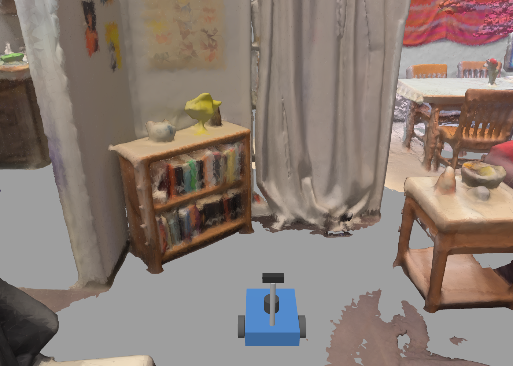

*Our robot inside a 3D copy of a real apartment. Every piece of furniture comes from an RGB-D scan that was
mapped with visual SLAM, fused into a mesh, and exported to the Gazebo simulator.*

This project builds the complete visual-robotics chain on one laptop (CPU only, no GPU): **real RGB-D video ->
visual SLAM -> dense 3D map -> Gazebo digital twin -> SLAM evaluation against perfect ground truth -> autonomous
navigation**. The SLAM stage was built **twice**, with two very different feature front ends, and the two
pipelines were compared on identical data:

| | Pipeline 1 | Pipeline 2 |
|---|---|---|
| SLAM | [ORB-SLAM3](https://github.com/UZ-SLAMLab/ORB_SLAM3) (C++) | `splg_slam/`, written for this project (Python) |
| Features | ORB: hand-crafted corners + binary descriptors | [SuperPoint](https://github.com/magicleap/SuperPointPretrainedNetwork): learned CNN keypoints + descriptors |
| Matching | Descriptor distance + ratio test | [LightGlue](https://github.com/cvg/LightGlue): learned attention matcher |
| Loop closure | DBoW2 bag of words + essential graph + bundle adjustment | LightGlue-verified loops + SE(3) pose graph |
| Run with | `tools/run_orbslam3.sh` | `tools/run_splg.sh` (same arguments, same output files) |

Both pipelines write the same output files, so mapping, twin export, Gazebo and navigation are shared.

**In one sentence:** learned features never lost the map, even in conditions where ORB-SLAM3 broke apart, but they
cost about 30x more compute on a CPU, while ORB-SLAM3 stays the more precise and much faster choice on
well-textured scenes (see [Conclusion](#conclusion)).

The full illustrated guide (39 pages, plain language) is in
**[docs/Visual_SLAM_Project_Guide.pdf](docs/Visual_SLAM_Project_Guide.pdf)**, and the detailed comparison in
**[results/COMPARISON.md](results/COMPARISON.md)**.

---

## Results at a glance

| What | Pipeline 1: ORB-SLAM3 | Pipeline 2: SuperPoint + LightGlue |
|---|---|---|
| Sequences tracked in one continuous map (of 6) | 3 | **6** |
| Real office video, TUM fr3 (22 m loop, motion-capture ground truth) | **1.56 cm** | 2.66 cm |
| Hardest twin run A (robot camera at 0.37 m) | 5 breaks, 20% continuous | **0 breaks, 100%, 2.07 cm** |
| HD twin run C (robot camera at 1.2 m) | 2.75 cm | **1.19 cm** |
| Real apartment, BundleFusion apt0 (86 m), mean / worst error | 10.8 / 76.8 cm | **8.3 / 17.2 cm** |
| Apartment map surface error vs reference map | 5.55 cm | 5.63 cm |
| Speed on this CPU (median per frame) | **13 to 25 ms** | 300 to 570 ms |
| Robot navigation in its apartment twin | goals reached within ~10 cm | goals reached within 11 to 12 cm |

Same frames for both (every 2nd frame of the 30 Hz real videos, every frame of the 15 Hz twin recordings), RGB-D
input, SE(3)-aligned ATE. Twin runs are scored against exact Gazebo ground truth.


---

## How it fits together

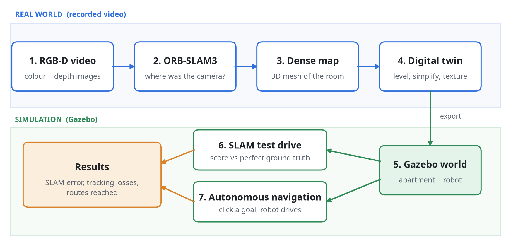

| Stage | What happens | Tool |
|---|---|---|
| 1. Record | Colour + depth video from public datasets | TUM RGB-D, Stanford BundleFusion |
| 2. Localize | Camera pose for every frame | **Pipeline 1:** ORB-SLAM3 &middot; **Pipeline 2:** `splg_slam` |
| 3. Map | Depth images fused at those poses into a coloured mesh | Open3D TSDF (`VoxelBlockGrid`), `tools/build_map.py` |
| 4. Twin | Level, square, simplify and texture the mesh; write a Gazebo model + world | `tools/export_gazebo.py`, `tools/make_robot_world.py` |
| 5. Robot | Differential-drive robot with lidar, RGB-D camera, IMU, ground-truth pose | Gazebo Harmonic, SDF |
| 6. Test SLAM | Robot drives a loop; SLAM maps from its camera; scored against the exact pose | `tools/sim_collect.py`, `tools/eval_segments.py` |
| 7. Navigate | Click a goal: A* plan, pure-pursuit control, lidar replanning | `tools/navigate.py` |

---

## 1. Visual SLAM on real video

Both pipelines track image features from frame to frame, keep a map of keyframes, and close loops when they recognise
a place. They differ in *which* features they track and how they match them.

<p align="center">
  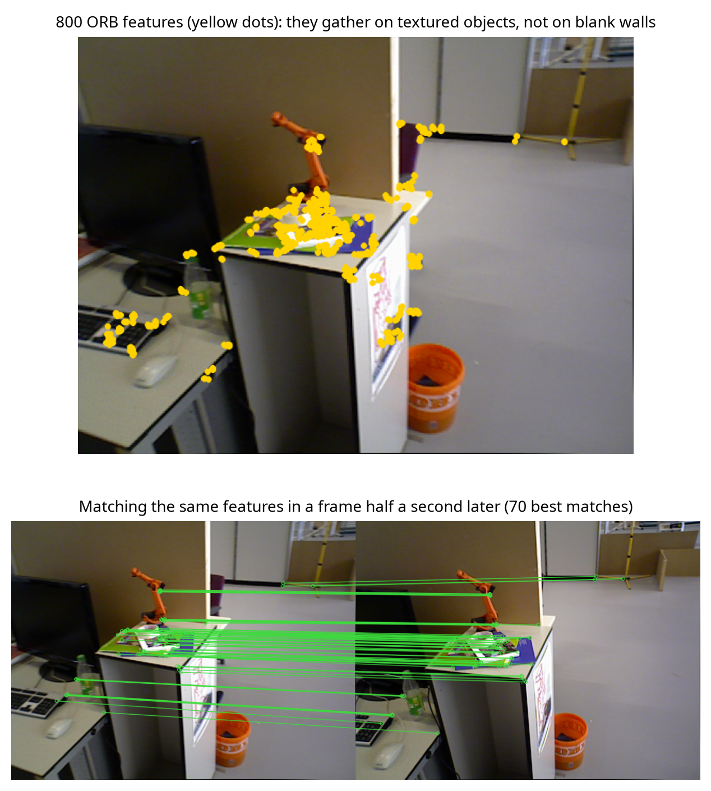
  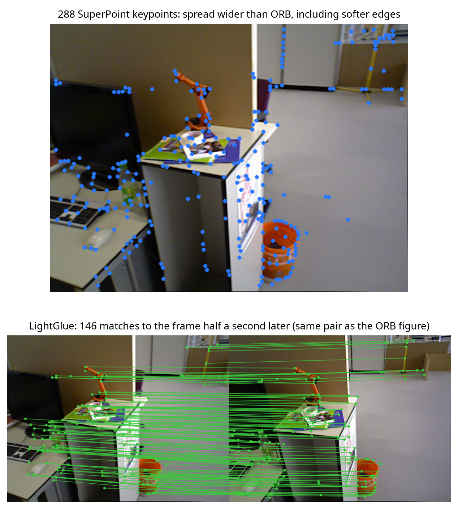
</p>

*Same real frame pair. Left: ORB (pipeline 1). Right: SuperPoint keypoints and LightGlue matches (pipeline 2).*

Pipeline 2 follows the same keyframe design as ORB-SLAM3, so the comparison isolates the features:

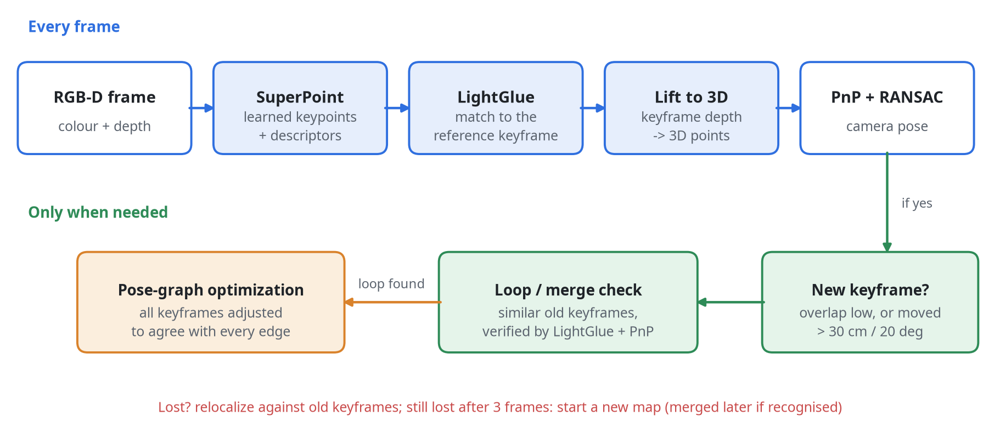

On the real office video both follow the motion-capture path closely; ORB-SLAM3 is slightly more precise here:


## 2. Dense 3D map

Every depth image is placed at its SLAM pose and fused into a truncated signed distance field (TSDF); marching cubes
then extracts a mesh. The same tool works on either pipeline's poses.

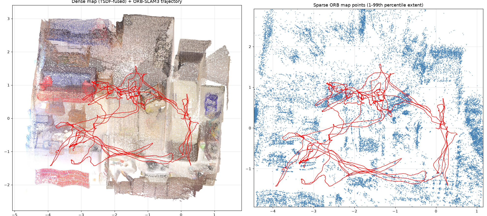

## 3. Digital twin in Gazebo

`tools/export_gazebo.py` turns the raw mesh into a simulator-ready model:

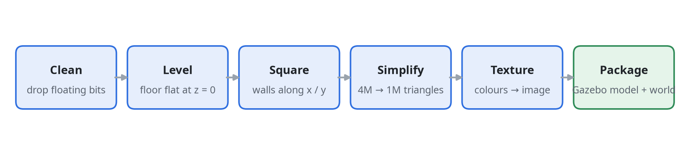

- **Level**: RANSAC finds the floor; gravity is estimated as the camera's down-axis averaged over the whole walk.
- **Square**: rotate so the walls align with x and y, and centre the apartment.
- **Simplify**: quadric decimation produces a visual mesh and a lighter collision mesh. The collision mesh gets a flat floor, because the lumpy scanned floor stalls wheels.
- **Texture**: a fast per-triangle atlas, Morton (Z-order) arranged so neighbouring triangles share texture space, coloured from the full-resolution mesh.

Twins built: `apt0` (pipeline 1, 2 cm), `apt0_hd` (pipeline 1, 1 cm, 1M triangles, 8K texture) and `apt0_splg`
(pipeline 2). The pipeline 2 twin landed within 2 cm of the pipeline 1 twin after automatic levelling.

<p align="center">
  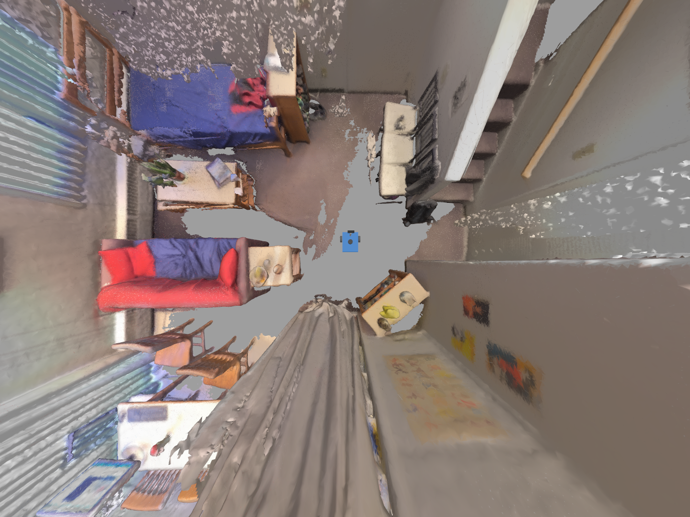
  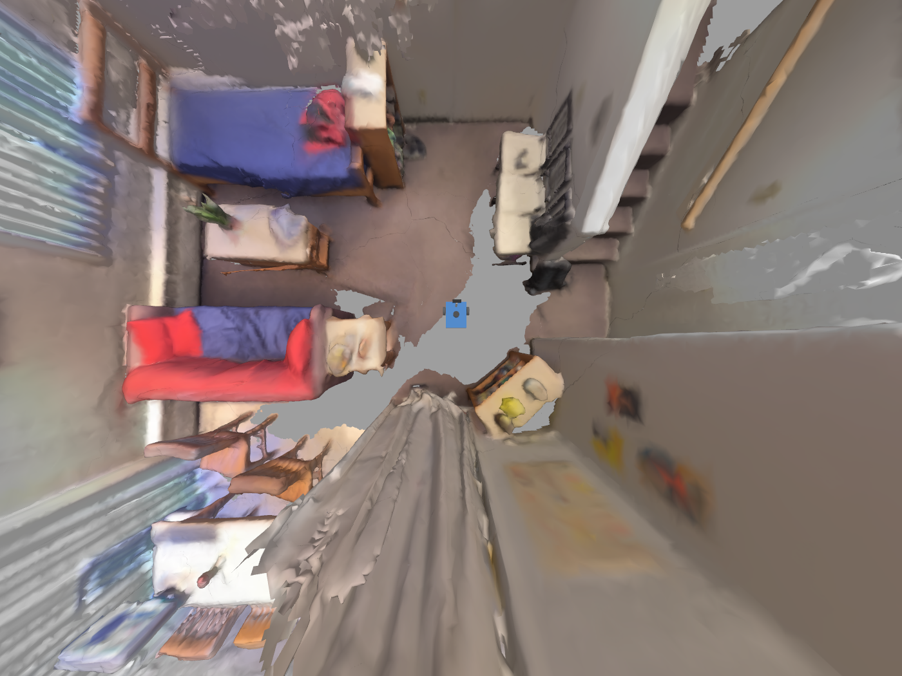
</p>

*Left: HD twin from pipeline 1. Right: twin from pipeline 2. The robot is the small blue square.*

## 4. The robot: scout_bot

<p align="center">
  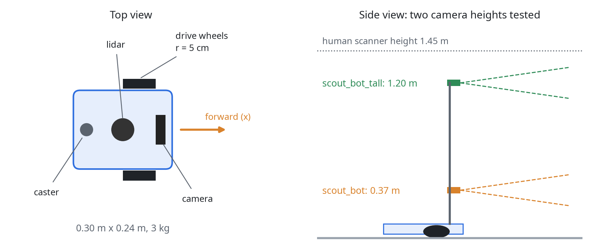
</p>

| Sensor / actuator | Topic | Details |
|---|---|---|
| Differential drive | `/cmd_vel`, `/odom` | 2 wheels, r = 5 cm, 0.28 m apart |
| 2D lidar (`gpu_lidar`) | `/scan` | 360 beams, 10 Hz, 0.12 to 8 m |
| RGB-D camera | `/camera/image`, `/camera/depth_image` | 640x480, 15 Hz, 60° FOV |
| IMU | `/imu` | 100 Hz |
| Ground truth (`PosePublisher`) | `/model/scout_bot/pose` | Exact pose, 100 Hz |

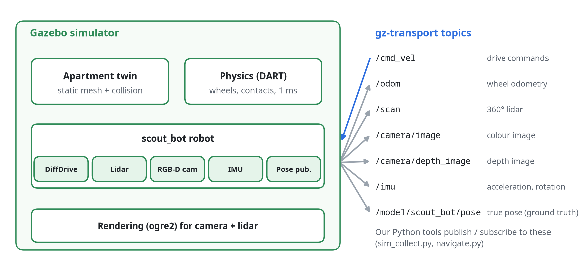

## 5. Testing SLAM inside the twin

The simulator knows the robot's exact position, so SLAM can be scored perfectly while one condition is changed at a
time:

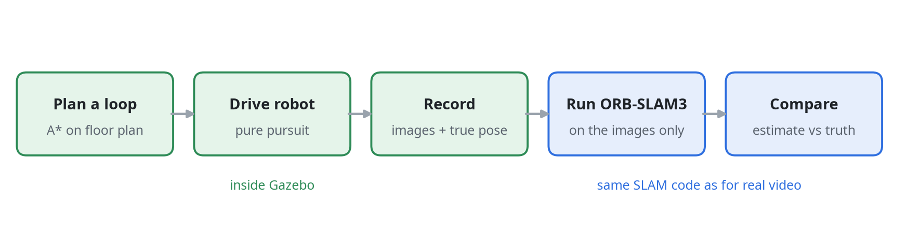

| Run | Change | Pipeline 1: ORB-SLAM3 | Pipeline 2: SuperPoint + LightGlue |
|---|---|---|---|
| A | Camera 0.37 m, 2 cm twin | 5 breaks, longest 20% | **0 breaks, 100%, 2.07 cm** |
| B | A + slower turns | 6 breaks, longest 20% (same places) | **0 breaks, 100%, 1.30 cm** |
| D | Camera 1.2 m (scanner height) | 4 breaks + 2 merges, longest 36% | **0 breaks, 100%, 1.33 cm** |
| C | D + 1 cm HD twin | 0 breaks, 2.75 cm | 0 breaks, **1.19 cm** |

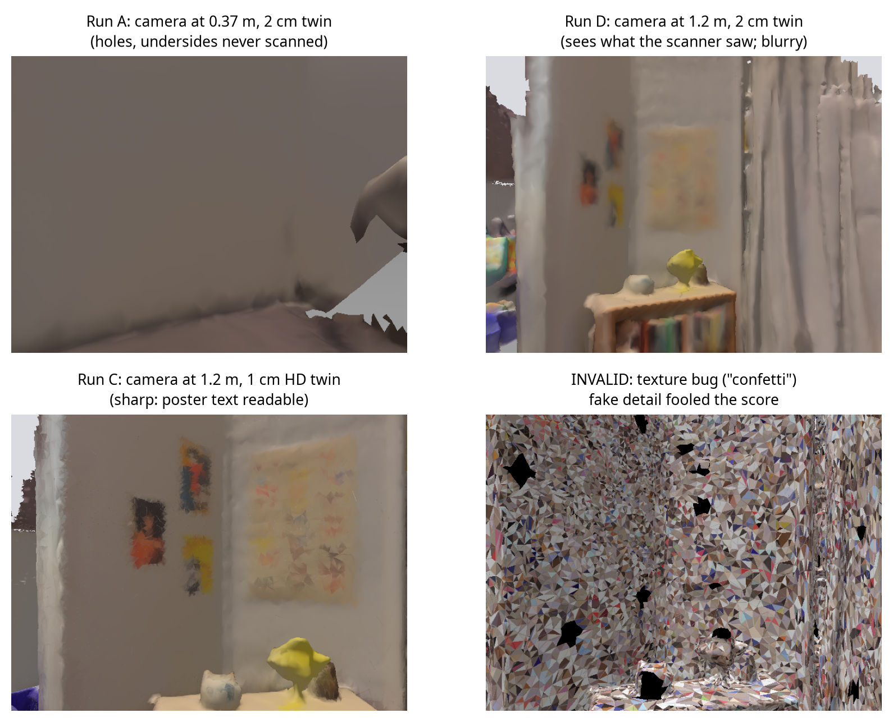

With ORB-SLAM3, these runs showed that a scanned twin is only reliable for testing SLAM when it was **scanned from the
robot's viewpoint** and has **sharp enough texture**. Pipeline 2 tracked all four runs anyway:

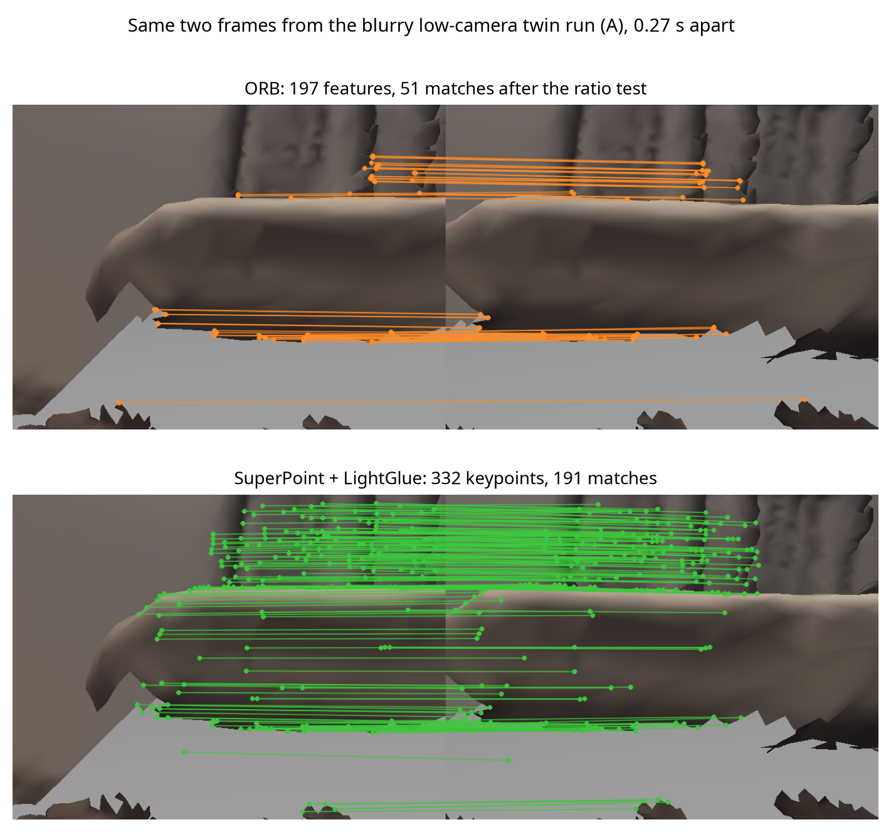

*Same two frames of twin run A. ORB finds 51 matches, almost all on two edges; LightGlue finds 191, spread over the
soft curtain folds. More, better-spread matches give PnP a stable pose.*


## 6. Map quality

Each pipeline's apartment poses were fused into a 2 cm map and compared with a map fused from BundleFusion's reference
poses (same frames, same settings).

| Pipeline | Mean surface error | Median | Map within 5 cm | Reference covered |
|---|---|---|---|---|
| ORB-SLAM3 | 5.55 cm | 4.12 cm | 59% | 63% |
| SuperPoint + LightGlue | 5.63 cm | 4.32 cm | 57% | 59% |


The maps are practically identical: ORB-SLAM3's 77 cm trajectory spike lasted only a few frames, and TSDF fusion
averaged it away.

## 7. Autonomous navigation

Click a point on the floor plan; the robot plans, drives and avoids surprises. It works the same in either pipeline's
twin.

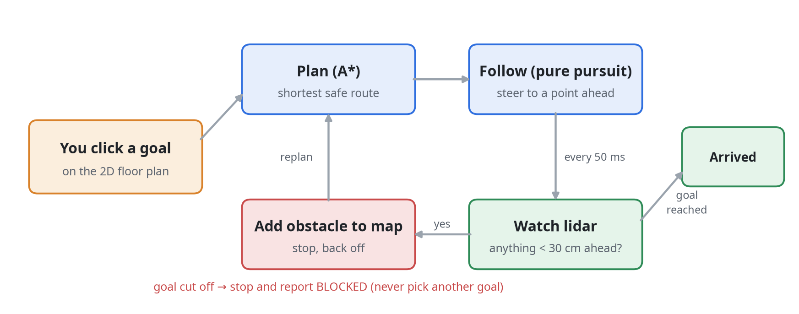

<p align="center">
  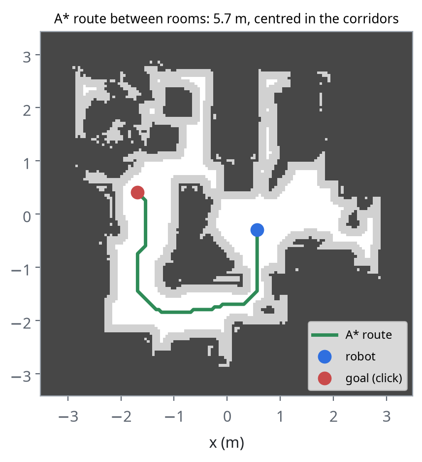
  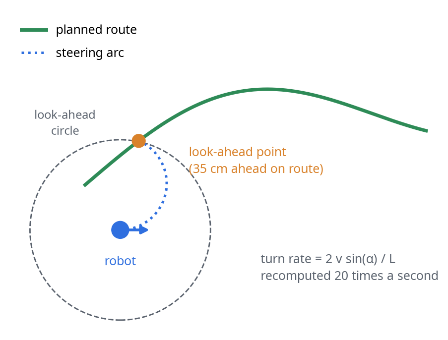
</p>

- **Map**: a 5 cm occupancy grid from the scanned mesh, inflated by the robot's radius with a distance transform.
- **Plan**: A* on an 8-connected grid, with a clearance-weighted cost so routes stay centred in corridors.
- **Follow**: pure pursuit with a 0.35 m look-ahead; turn in place for sharp corners, slow down near the goal.
- **Safety**: an unmapped obstacle within 30 cm ahead (lidar) stops the robot, which adds it to the map and replans to the *same* goal. If the goal is cut off, it reports BLOCKED; it never substitutes another goal.

Tested headless: goals in different rooms reached within about 10 cm; a box dropped on the only corridor gives
BLOCKED; a box dropped in open space is driven around (4 replans) to the real goal.

---

## Conclusion

1. **The full chain works end to end, with either SLAM.** Real video became a navigable digital twin with both
   pipelines; the resulting maps are equally accurate (5.55 vs 5.63 cm surface error) and the robot navigates both.
2. **Learned features buy robustness.** SuperPoint + LightGlue kept one continuous map on all 6 sequences.
   ORB-SLAM3 broke into 5 to 7 pieces on three twin runs, exactly where texture was blurry, the scan had holes, or the
   camera saw surfaces the scanner never filmed. LightGlue also verified far more loops (643 vs 5 on the apartment),
   which held the apartment's worst-case error to 17 cm instead of 77 cm.
3. **Hand-crafted features still win on precision and speed in good conditions.** On well-textured real video
   ORB-SLAM3 was more accurate (1.56 vs 2.66 cm), thanks to full bundle adjustment of points and poses, and it ran
   about 30x faster on this CPU.
4. **A digital twin is only as good as its scan.** With ORB-SLAM3, simulated SLAM matched real-world behaviour only
   once the twin was scanned from the robot's viewpoint (camera height) *and* textured at 1 cm detail.
5. **A better trajectory does not automatically mean a better map.** Short error spikes average out in TSDF fusion;
   measure the output you actually use.

**Which SLAM, when?**

| Situation | Recommended |
|---|---|
| CPU-only robot, well-textured environment, real-time needed | **ORB-SLAM3** |
| Blurry, low-texture or unusual viewpoints; robustness matters more than speed | **SuperPoint + LightGlue** |
| A GPU is available | **SuperPoint + LightGlue**, and add local bundle adjustment to close the precision gap |
| Testing SLAM in a scanned twin | Either, but scan from the robot's height and fuse at 1 cm first |

Main caveats: pipeline 2 is new single-threaded Python code tuned on 200 frames, compared with a mature multi-threaded
C++ system; it ran on a CPU, not the GPU these networks are designed for; and SuperPoint's weights are for
non-commercial use only. Details in [results/COMPARISON.md](results/COMPARISON.md).

---

## Quick start

### Requirements

- Ubuntu 24.04, Python 3.12
- Build tools and libraries:
  ```bash
  sudo apt-get install -y build-essential cmake pkg-config libeigen3-dev libopencv-dev libglew-dev libepoxy-dev \
      libgl1-mesa-dev libwayland-dev libxkbcommon-dev wayland-protocols libboost-serialization-dev libssl-dev python3-dev
  ```
- Gazebo Harmonic (`gz-harmonic`, from the [OSRF apt repository](https://gazebosim.org/docs/harmonic/install_ubuntu)); this also installs its Python bindings.
- Python environment:
  ```bash
  python3 -m venv .venv
  .venv/bin/python -m pip install open3d numpy scipy matplotlib opencv-python reportlab pypdf
  # pipeline 2: CPU PyTorch + LightGlue (SuperPoint/LightGlue weights download on first run)
  .venv/bin/python -m pip install torch torchvision --index-url https://download.pytorch.org/whl/cpu
  .venv/bin/python -m pip install "git+https://github.com/cvg/LightGlue.git"
  # let the venv import Gazebo's Python bindings (python3-gz-transport13, python3-gz-msgs10)
  echo /usr/lib/python3/dist-packages > $(.venv/bin/python -c "import site; print(site.getsitepackages()[0])")/zz_system_gz.pth
  ```

### Pipeline 1: build ORB-SLAM3

```bash
mkdir -p third_party && cd third_party
git clone --depth 1 https://github.com/UZ-SLAMLab/ORB_SLAM3.git
git clone --depth 1 --branch v0.8 https://github.com/stevenlovegrove/Pangolin.git
cd ..
tools/build_orbslam3.sh   # applies tools/orbslam3_ubuntu24.patch (C++17, GCC 13 fix, map export) and builds
```

### Data

```bash
mkdir -p data && cd data
# TUM office sequence (1.5 GB)
curl -LO https://cvg.cit.tum.de/rgbd/dataset/freiburg3/rgbd_dataset_freiburg3_long_office_household.tgz
tar xzf rgbd_dataset_freiburg3_long_office_household.tgz
# Stanford BundleFusion apartment (1.2 GB)
curl -LO https://graphics.stanford.edu/projects/bundlefusion/data/apt0/apt0.zip
mkdir apt0 && unzip -q apt0.zip -d apt0
cd ..
.venv/bin/python tools/prepare_bundlefusion.py data/apt0/apt0     # convert to TUM format + camera YAML
```

### Apartment: SLAM -> map -> Gazebo -> navigation

Pick a pipeline; every later step is the same.

```bash
# Pipeline 1 (ORB-SLAM3, a few minutes, live viewer; ORB_NO_VIEWER=1 for headless)
MAP_ARGS="--voxel 0.02 --depth-max 4" tools/run_orbslam3.sh \
    data/apt0/apt0 data/apt0/apt0/associations.txt data/apt0/apt0.yaml runs/apt0

# Pipeline 2 (SuperPoint + LightGlue, about 1 hour on a CPU; last argument = frame stride)
MAP_ARGS="--voxel 0.02 --depth-max 4 --every 2" tools/run_splg.sh \
    data/apt0/apt0 data/apt0/apt0/associations.txt data/apt0/apt0.yaml runs/splg_apt0 2

# view the map in 3D (mesh | cloud | sparse)
.venv/bin/python tools/view_map.py --run runs/apt0            # or runs/splg_apt0

# Gazebo twin + robot world (use runs/splg_apt0 and --name apt0_splg for pipeline 2)
.venv/bin/python tools/export_gazebo.py --run runs/apt0 --name apt0
.venv/bin/python tools/make_robot_world.py --map apt0

# click-to-go navigation (or --goal x y)
.venv/bin/python tools/navigate.py --world apt0_robot --map apt0
```

Optional HD twin (1 cm, 8K texture), from either pipeline's run:

```bash
mkdir -p runs/apt0_1cm && cp runs/apt0/*.txt runs/apt0_1cm/          # same SLAM poses, re-fused at 1 cm
.venv/bin/python tools/build_map.py --data data/apt0/apt0 --run runs/apt0_1cm \
    --assoc data/apt0/apt0/associations.txt --config data/apt0/apt0.yaml --voxel 0.01 --depth-max 4
.venv/bin/python tools/export_gazebo.py --run runs/apt0_1cm --name apt0_hd --align-like apt0 \
    --visual-tris 1000000 --collision-tris 100000 --tex-size 8192 --texture per-triangle
.venv/bin/python tools/make_robot_world.py --map apt0_hd
```

### Testing SLAM in the twin, and the full comparison

```bash
# drive the robot yourself (arrow keys, S = stop)
tools/run_gazebo.sh apt0_hd_robot

# record a test drive with exact ground truth, run either SLAM on it, score it
.venv/bin/python tools/sim_collect.py --out data/sim_run --gui --map apt0_hd \
    --world apt0_hd_robot_tall --cam-z 1.20 --obst-top 1.3
tools/run_orbslam3.sh data/sim_run data/sim_run/associations.txt data/sim_run/camera.yaml runs/sim_run
.venv/bin/python tools/eval_segments.py --run runs/sim_run --gt data/sim_run/groundtruth.txt

# both pipelines on identical frames of all 6 sequences, then tables + charts
tools/compare_all.sh && .venv/bin/python tools/compare_report.py
```

---

## Repository layout

```
tools/
  build_orbslam3.sh        build Pangolin + ORB-SLAM3 into third_party/ (applies the patch below)
  orbslam3_ubuntu24.patch  our ORB-SLAM3 changes: C++17, GCC 13 fix, SaveMapPoints(), ORB_NO_VIEWER
  run_orbslam3.sh          pipeline 1: ORB-SLAM3 RGB-D, then dense map + evaluation
  run_splg.sh              pipeline 2: SuperPoint+LightGlue SLAM, then dense map + evaluation
  build_map.py             ATE (Umeyama SE3/Sim3), sparse map, TSDF dense map, previews
  prepare_bundlefusion.py  BundleFusion -> TUM format + ORB-SLAM3 camera YAML
  view_map.py              interactive 3D viewer (Open3D)
  export_gazebo.py         mesh -> levelled, textured Gazebo model + world
  make_robot_world.py      add scout_bot to a twin, spawning it in open space
  run_gazebo.sh            launch a world with the model path set
  sim_collect.py           autonomous recording drive with exact ground truth
  eval_segments.py         per-segment ATE for runs that split into several maps
  navigate.py              click-to-go navigation (A*, pure pursuit, lidar replanning)
  compare_all.sh           run both pipelines on identical frames of all 6 sequences
  compare_report.py        comparison tables + charts (results/, docs/figures/cmp_*)
splg_slam/                 pipeline 2: frontend.py (SuperPoint+LightGlue), slam.py (tracking, keyframes,
                           relocalization, loops, map merging), posegraph.py (SE(3) pose graph), run.py
gazebo/
  models/                  twins: apt0, apt0_hd, apt0_splg   robots: scout_bot, scout_bot_tall
  worlds/                  each twin with and without the robot (apt0_robot, apt0_hd_robot, apt0_splg_robot, ...)
docs/
  Visual_SLAM_Project_Guide.pdf   the illustrated guide (39 pages)
  make_figures.py, render_gazebo_views.py, build_guide.py   regenerate it
  figures/                 every diagram and result image
results/
  REPORT.md                pipeline 1 results (real data, twin experiments)
  COMPARISON.md            pipeline 1 vs pipeline 2: verdict, tables, map quality, navigation
  comparison_table.md      generated full comparison table
ROADMAP.md, labs/, vslam/, tests/, check.py   from-scratch SLAM course (Lab 0 scaffolded)
*.py (root), r_*/, results_*/                 the first monocular VO prototype (TUM fr1_xyz)
data/, runs/, third_party/                    datasets, SLAM outputs, ORB-SLAM3 (git-ignored)
gazebo/models/apt0*/meshes/                   generated twin meshes (git-ignored, up to 153 MB): run the export step
```

Rebuild the guide and its figures:

```bash
.venv/bin/python docs/make_figures.py && .venv/bin/python docs/render_gazebo_views.py && .venv/bin/python docs/build_guide.py
```

---

## Problems solved along the way

Twenty-four problems came up; all of them, with root causes, are in chapter 12 of the guide. The most instructive:

| Problem | Cause | Fix |
|---|---|---|
| ORB-SLAM3 / Pangolin will not compile on Ubuntu 24.04 | GCC 13: missing `<cstdint>`, C++17 needed, `++` on a `bool` | `-include cstdint`, `-std=c++17`, `bool` -> `int` in `LoopClosing.h` |
| Open3D TSDF returns an empty mesh | Legacy `ScalableTSDFVolume` bug in 0.20 | Tensor `VoxelBlockGrid` with a weight threshold |
| Twin placed 1.4 m underground | Sign error in the floor transform | Caught because camera height came out negative |
| Robot stalls on open floor | Lumpy scanned floor in the collision mesh | Flat physics floor; scan kept for visuals |
| A "perfect" SLAM score in simulation | Texture v-axis flipped for Gazebo: confetti texture gave fake features | Caught because the twin had more texture than reality; fixed and re-run |
| Robot "arrived" somewhere else | Planner silently snapped an unreachable goal | Keep the real goal; report BLOCKED |
| SuperPoint took 1.6 s per image | Hybrid CPU (4 fast + 10 slow cores); oneDNN slow at 640 px | 8 threads + 480 px input: 0.2 s |
| Pipeline 2 slowed to 2.3 s per frame | Pose-graph cost computed edge by edge | Vectorized with NumPy; verified on a synthetic graph |
| Gazebo GUI crashes when launched from the navigator | opencv-python's Qt plugin path leaked into Gazebo | Strip `QT_QPA_*` variables for the Gazebo process |

## Limitations and next steps

- [ ] Navigate on **live SLAM poses** (either pipeline) instead of the simulator's ground truth
- [ ] Add **local bundle adjustment** to pipeline 2 to close its precision gap on well-textured scenes
- [ ] Run pipeline 2 on a **GPU**, where SuperPoint and LightGlue are designed to run
- [ ] Add motion blur, noise and exposure change to the simulated camera; the twin is slightly easier than reality
- [ ] Routes that revisit places, to exercise ORB-SLAM3's loop closure in the twin (it closed none there)
- [ ] ROS 2 Jazzy + Nav2 + slam_toolbox on the same twin
- [ ] Finish the from-scratch SLAM labs and benchmark them against both pipelines

## Acknowledgements

- [ORB-SLAM3](https://github.com/UZ-SLAMLab/ORB_SLAM3), Campos et al., *IEEE T-RO* 2021 (GPLv3)
- [SuperPoint](https://github.com/magicleap/SuperPointPretrainedNetwork), DeTone et al., CVPRW 2018 (weights: non-commercial licence)
- [LightGlue](https://github.com/cvg/LightGlue), Lindenberger et al., ICCV 2023 (Apache 2.0)
- [TUM RGB-D benchmark](https://cvg.cit.tum.de/data/datasets/rgbd-dataset), Sturm et al., IROS 2012 (CC BY 4.0)
- [BundleFusion dataset](https://graphics.stanford.edu/projects/bundlefusion/), Dai et al., *ACM TOG* 2017
- [Open3D](https://www.open3d.org/), [Gazebo Harmonic](https://gazebosim.org/), [Pangolin](https://github.com/stevenlovegrove/Pangolin)

Author: Azad Kumar Jha
