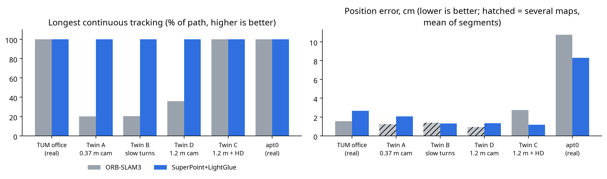
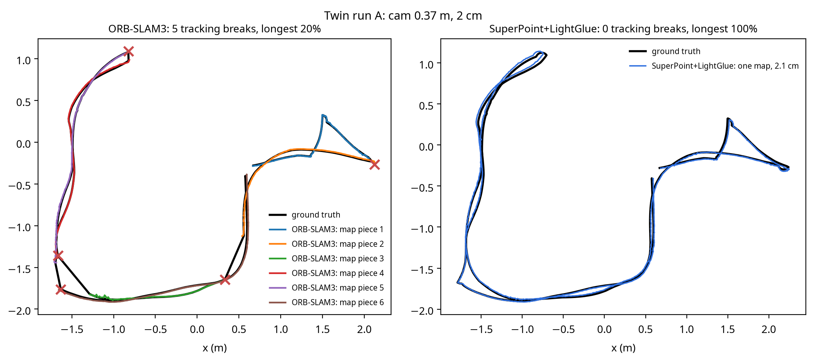
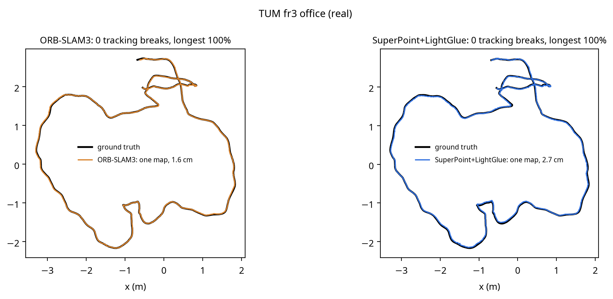
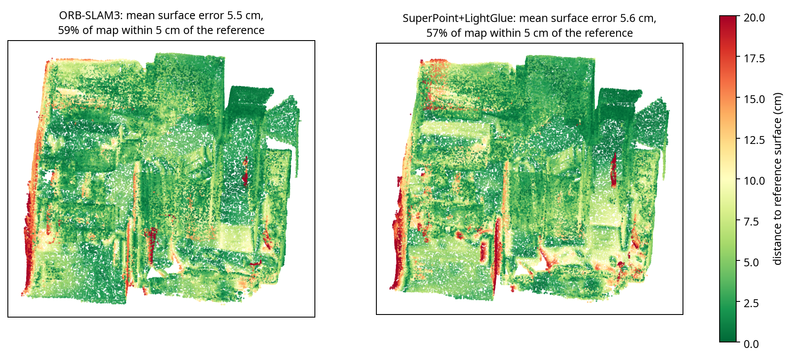

# Pipeline 1 (ORB-SLAM3) vs Pipeline 2 (SuperPoint + LightGlue)

**Verdict:** learned features made SLAM far more **robust**. SuperPoint + LightGlue never lost the map on
any of the 6 sequences, while ORB-SLAM3 broke into 5 to 7 pieces on three of the four twin runs. Accuracy is
mixed: ORB-SLAM3 is more accurate on the easy real office video (1.56 vs 2.66 cm); SuperPoint + LightGlue is more
accurate on the hard ones (twin C 1.19 vs 2.75 cm, apartment 8.3 vs 10.8 cm, worst case 17 vs 77 cm). The price
is speed: about **30x slower** on this CPU-only laptop (0.3 to 0.57 s vs 13 to 25 ms per frame). Both pipelines
produce equally good maps, and both drive the robot.



## 1. What was compared

| | Pipeline 1 | Pipeline 2 |
|---|---|---|
| SLAM | ORB-SLAM3 (C++) | `splg_slam/` (Python, written for this project) |
| Features | ORB: FAST corners + 256-bit binary descriptor | SuperPoint: learned CNN keypoints + 256-D descriptor |
| Matching | Descriptor distance + ratio test, projection search | LightGlue: learned attention matcher |
| Tracking | Motion model + map-point projection, motion-only BA | PnP-RANSAC on the reference keyframe's depth-lifted points |
| Place recognition | DBoW2 bag of words | Mean-descriptor similarity + distance, verified by LightGlue + PnP |
| Back end | Local BA, essential-graph optimization, Atlas merging | SE(3) pose graph (sequential + neighbour + loop edges), map merging |
| Run with | `tools/run_orbslam3.sh` | `tools/run_splg.sh` (same arguments) |

**Fairness:** both see exactly the same frames (`runs/cmp/assoc/`): every 2nd frame of the 30 Hz real sequences,
every frame of the 15 Hz twin recordings. Both are RGB-D. All runs and scoring: `tools/compare_all.sh`,
`tools/compare_report.py`. SuperPoint runs on images resized to 480 px (about 4x faster on this CPU, measured).

## 2. Trajectory results

| Dataset | Pipeline | Breaks | Longest continuous | ATE (cm) | Max (cm) | Loops | ms / frame |
|---|---|---|---|---|---|---|---|
| TUM fr3 office (real, mocap GT) | ORB-SLAM3 | 0 | 100% | **1.56** | 7.57 | 1 | 18 |
| | SuperPoint+LightGlue | 0 | 100% | 2.66 | **5.72** | 34 | 296 |
| Twin A: camera 0.37 m, 2 cm twin | ORB-SLAM3 | 5 | 20% | (1.22 per piece) | | 0 | 13 |
| | SuperPoint+LightGlue | **0** | **100%** | 2.07 | 4.79 | 10 | 457 |
| Twin B: A + slow turns | ORB-SLAM3 | 6 | 20% | (1.39 per piece) | | 0 | 13 |
| | SuperPoint+LightGlue | **0** | **100%** | 1.30 | 3.71 | 11 | 486 |
| Twin D: camera 1.2 m, 2 cm twin | ORB-SLAM3 | 4 (+2 merges) | 36% | (0.94 per piece) | | 0 | 16 |
| | SuperPoint+LightGlue | **0** | **100%** | 1.33 | 4.15 | 18 | 539 |
| Twin C: camera 1.2 m, HD twin | ORB-SLAM3 | 0 | 100% | 2.75 | 6.16 | 0 | 16 |
| | SuperPoint+LightGlue | 0 | 100% | **1.19** | **3.11** | 17 | 569 |
| BundleFusion apt0 (real, reference poses) | ORB-SLAM3 | 0 | 100% | 10.75 | 76.81 | 5 | 25 |
| | SuperPoint+LightGlue | 0 | 100% | **8.29** | **17.24** | 643 | 452 |

The full generated table is in [comparison_table.md](comparison_table.md). The twin errors are against exact
Gazebo ground truth, the office against motion capture, and apt0 against BundleFusion's own estimate.





## 3. Map quality (apartment)

Each pipeline's poses were fused into a 2 cm TSDF map, then compared with a map fused from BundleFusion's
reference poses (same frames, same settings).

| Pipeline | Mean surface error | Median | Map within 5 cm | Reference covered (5 cm) |
|---|---|---|---|---|
| ORB-SLAM3 | 5.55 cm | 4.12 cm | 59% | 63% |
| SuperPoint+LightGlue | 5.63 cm | 4.32 cm | 57% | 59% |

The maps are practically the same. ORB-SLAM3's 77 cm trajectory spike lasted only a few frames, and TSDF fusion
averaged it away. A better trajectory does not automatically give a better map.



## 4. SLAM to navigation

The SuperPoint + LightGlue apartment map was exported as its own Gazebo twin (`gazebo/models/apt0_splg`,
world `apt0_splg_robot`). Its automatic levelling and centring landed within 2 cm of the ORB-SLAM3 twin's. The
navigator drove the robot to two goals in it (1.7 m and 2.4 m routes) and arrived 11 to 12 cm from each, the
same as in the ORB-SLAM3 twin.

```bash
.venv/bin/python tools/navigate.py --world apt0_splg_robot --map apt0_splg
```

## 5. Why learned features helped where they did

- **Blurry, low-detail texture** (twins A, B, D): ORB needs sharp corners and found as few as 45 per frame.
  SuperPoint still finds repeatable points on soft gradients, and LightGlue matches them using the context of
  all the other points, not just each descriptor alone.
- **Unscanned holes and odd viewpoints** (twin A from 0.37 m): LightGlue's matches stay consistent where ORB's
  ratio test throws most of them away.
- **Loop closure:** LightGlue verifies far more candidate loops (643 on apt0 against ORB-SLAM3's 5), which kept the
  apartment's worst-case error at 17 cm instead of 77 cm.
- **Where ORB-SLAM3 still wins:** on easy, well-textured real video its joint bundle adjustment of map points and
  poses is more precise than our pose-graph-only back end (1.56 vs 2.66 cm), and it is about 30x faster.

## 6. Caveats

- Pipeline 2 runs everything in one Python thread. ORB-SLAM3 runs mapping and loop closing in parallel threads, so
  their ms/frame are not a like-for-like measure of algorithm cost. SuperPoint and LightGlue are designed for GPUs; on one, pipeline 2 would be several times faster (not measured here: this laptop has no GPU).
- Pipeline 2's back end is simpler (pose graph only, no bundle adjustment of points). Adding local BA would likely
  close the gap on the office sequence.
- The pipeline 2 code is new and tuned only on 200 office frames. ORB-SLAM3 is a mature, published system.
- SuperPoint's pretrained weights are released for non-commercial use (Magic Leap licence).
